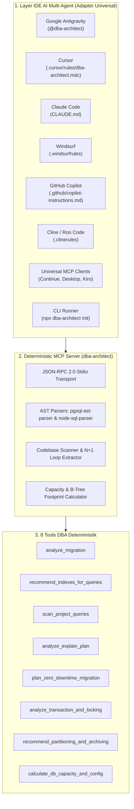

<div align="center">

# 🗄️ DBA-Architect

**Principal Database Administrator (DBA) & Data Architecture AI Skill Agent + MCP Server**  
*Audit migrasi SQL secara otomatis, optimasi composite B-Tree index berbasis aturan ESR, eliminasi N+1 query, analisis EXPLAIN plan, eksekusi migrasi zero-downtime, dan cegah deadlock transaksi pada PostgreSQL & MySQL.*

[](LICENSE)
[](package.json)
[](https://nodejs.org)
[](https://www.typescriptlang.org)
[](https://modelcontextprotocol.io)
[](https://www.postgresql.org)
[](https://www.mysql.com)
[](tests)
[](https://www.w3.org/WAI/standards-guidelines/wcag/)

[English](README.md) | [Bahasa Indonesia](README.id.md)

</div>

---

## 🌟 Ringkasan

**DBA-Architect** menjembatani kesenjangan antara penulisan kode backend dan *database performance engineering* tingkat lanjut. Seringkali AI coding assistant menghasilkan rekomendasi SQL atau index secara spekulatif; **DBA-Architect** menggantikan tebakan tersebut dengan **8 mesin analisis deterministik berbasis AST & heuristik** yang terstandarisasi layaknya Principal DBA.

Baik Anda sedang menulis migrasi DDL pada Prisma, mengoptimasi transaksi checkout e-commerce, atau mengelola tabel berukuran lebih dari 50 juta baris, DBA-Architect menghadirkan audit deterministik, diagram alur eksekusi Mermaid, dan *runbook* migrasi non-blocking langsung ke IDE AI Agent Anda.

### Fitur Utama
* 🛡️ **Mesin Deterministik Anti-Halusinasi**: Dilengkapi parser AST murni (`pgsql-ast-parser`, `node-sql-parser`) yang menegakkan 30+ aturan ketat DBA beserta skor kepatuhan **Schema Health Score (0–100)**.
* 🌐 **Ekosistem AI Multi-Agent Universal**: Adapter native untuk **Google Antigravity**, **Cursor**, **Anthropic Claude Code**, **Windsurf**, **GitHub Copilot**, **Cline / Roo Code**, **Continue.dev**, dan **Kiro AI IDE**.
* ⚡ **Rekayasa Index ESR**: Menerapkan algoritma pengurutan index komposit **Equality, Sort, Range**, mendeteksi predikat non-sargable, dan mengeliminasi index redundan *left-prefix*.
* 🚀 **Runbook Migrasi Zero-Downtime**: Mengubah perintah `ALTER TABLE` yang berisiko mengunci tabel menjadi tahapan aman **Expand & Contract** (`CONCURRENTLY`, `NOT VALID` ➔ `VALIDATE`, `ALGORITHM=INPLACE`).
* 🔒 **Pencegahan Race Condition & Deadlock**: Mendeteksi *lost updates* pada jalur finansial/stok, mewajibkan *pessimistic row locking* (`SELECT ... FOR UPDATE`), serta melarang pemanggilan HTTP eksternal di dalam blok transaksi.

---

## 🏗️ Arsitektur Sistem



---

## 🛠️ Matriks 8 Tools MCP & Katalog Aturan

| # | Nama Tool MCP | Fungsi & Pemicu Utama | Aturan Utama yang Ditegakkan |
| :--- | :--- | :--- | :--- |
| **1** | `analyze_migration` | Mengaudit file DDL/migrasi SQL dan menghitung **Health Score (0–100)**. | `SCHEMA-FLOAT-001`, `SCHEMA-FK-NOINDEX-001`, `SCHEMA-UUID-INNODB-001`, `SCHEMA-PG-ALIGN-001` |
| **2** | `recommend_indexes_for_queries` | Menyusun index komposit/covering B-Tree sesuai aturan ESR dan menandai predikat non-sargable. | `INDEX-ESR-001`, `INDEX-SARG-001..004`, `INDEX-REDUNDANT-001` |
| **3** | `scan_project_queries` | Memindai basis kode Go, PHP/Laravel, TypeScript, dan Python untuk mendeteksi perulangan N+1 dan konsolidasi index. | `CODE-NPLUS1-001`, `CODE-RAW-PII-001` |
| **4** | `analyze_explain_plan` | Mem-parsing output `EXPLAIN (ANALYZE, BUFFERS)` PostgreSQL/MySQL, menyoroti bottleneck, dan membuat diagram Mermaid. | `EXPLAIN-SCAN-001`, `EXPLAIN-SORT-001`, `EXPLAIN-ROWS-001` |
| **5** | `plan_zero_downtime_migration` | Menghasilkan runbook migrasi Expand & Contract yang aman tanpa downtime. | `MIGRATE-LOCK-001`, `MIGRATE-PHASE-001` |
| **6** | `analyze_transaction_and_locking` | Mengaudit blok transaksi ORM/SQL untuk mencegah race condition, deadlock, dan I/O HTTP di dalam transaksi. | `TX-RACE-001`, `TX-IO-001`, `TX-DEADLOCK-001` |
| **7** | `recommend_partitioning_and_archiving` | Merancang partisi deklaratif (`RANGE`, `LIST`, `HASH`) untuk tabel >10 juta baris beserta aturan composite PK. | `PART-PK-001`, `PART-RETENTION-001` |
| **8** | `calculate_db_capacity_and_config` | Menghitung overhead byte header, kapasitas storage GB, kecocokan RAM, serta tuning `postgresql.conf` / `my.cnf`. | `CAP-TUPLE-001`, `CONFIG-BUFFER-001` |

---

## 🚀 Panduan Instalasi & Penggunaan

### 🔌 Metode A: Konfigurasi MCP Server (Direkomendasikan)

Konfigurasikan IDE AI Anda untuk mengambil dan mengeksekusi server MCP langsung melalui `npx`:

#### 1. Google Antigravity & Gemini CLI
Tambahkan pada file `mcp_config.json` proyek atau global:
```json
{
  "mcpServers": {
    "dba-architect": {
      "command": "npx",
      "args": ["-y", "github:hanifalkauni/dba-architect"]
    }
  }
}
```

#### 2. Claude Desktop & Claude Code
Tambahkan pada `claude_desktop_config.json`:
```json
{
  "mcpServers": {
    "dba-architect": {
      "command": "npx",
      "args": ["-y", "github:hanifalkauni/dba-architect"]
    }
  }
}
```

#### 3. Cursor & Continue.dev
Pada Cursor (`Features` ➔ `MCP Servers`) atau Continue (`config.json`):
```json
{
  "name": "dba-architect",
  "command": "npx",
  "args": ["-y", "github:hanifalkauni/dba-architect"]
}
```

---

### 📦 Metode B: CLI Universal Agent Skills (`skills.sh`)

Pasang ke dalam Cursor, Claude Code, Windsurf, Copilot, atau Gemini CLI dengan satu perintah:
```bash
npx skills add hanifalkauni/dba-architect
```

---

### ⚡ Metode C: Injeksi Adapter Otomatis via CLI

Jalankan perintah ini di root direktori proyek Anda untuk mengekspor adapter ke semua IDE secara instan:
```bash
npx -y github:hanifalkauni/dba-architect init
```

---

### 💻 Metode D: Pemasangan Adapter Manual per IDE

<details>
<summary><b>🤖 Google Antigravity & Gemini CLI</b></summary>

Salin adapter ke direktori skill workspace:
```bash
mkdir -p .agents/skills/dba-architect
cp adapters/antigravity/SKILL.md .agents/skills/dba-architect/SKILL.md
```
</details>

<details>
<summary><b>🖱️ Cursor IDE</b></summary>

Salin rule ke direktori Cursor:
```bash
mkdir -p .cursor/rules
cp adapters/cursor/dba-architect.mdc .cursor/rules/dba-architect.mdc
```
</details>

<details>
<summary><b>🧠 Anthropic Claude Code</b></summary>

Salin instruksi ke root proyek:
```bash
cp adapters/claude/CLAUDE.md ./CLAUDE.md
```
</details>

<details>
<summary><b>🌊 Codeium Windsurf</b></summary>

Salin rules ke root proyek:
```bash
cp adapters/windsurf/.windsurfrules ./.windsurfrules
```
</details>

<details>
<summary><b>🐙 GitHub Copilot</b></summary>

Salin instruksi ke folder konfigurasi GitHub:
```bash
mkdir -p .github
cp adapters/copilot/copilot-instructions.md .github/copilot-instructions.md
```
</details>

<details>
<summary><b>⚡ Kiro AI IDE (kiro.dev)</b></summary>

Salin berkas steering dan konfigurasi MCP:
```bash
mkdir -p .kiro/steering
cp adapters/kiro/dba-architect.md .kiro/steering/dba-architect.md
cp adapters/kiro/config.json .kiro/config.json
```
</details>

---

## 📂 Struktur Direktori Repositori

```
dba-architect/
├── adapters/                           # Paket Adapter Lintas IDE AI
│   ├── antigravity/SKILL.md            # Skill Google Antigravity & Gemini CLI
│   ├── claude/CLAUDE.md                # Anthropic Claude Code & Desktop
│   ├── cline/.clinerules               # Aturan Otonom Cline / Roo Code
│   ├── continue/                       # Aturan & Konfigurasi MCP Continue.dev
│   ├── copilot/copilot-instructions.md # Instruksi Khusus GitHub Copilot
│   ├── cursor/dba-architect.mdc        # Aturan MDC Cursor (Globs & Frontmatter)
│   ├── kiro/                           # Steering File & Konfigurasi Kiro AI IDE
│   └── windsurf/.windsurfrules         # Aturan Windsurf Cascade
├── src/                                # Kode Sumber Mesin Utama
│   ├── adapters.ts                     # Mesin Installer Adapter CLI
│   ├── index.ts                        # Entrypoint Terpadu (CLI + MCP Stdio)
│   ├── server.ts                       # Implementasi MCP Server & Schema Registry
│   ├── constants/                      # Katalog Aturan DBA & Heuristik Deterministik
│   ├── parsers/                        # Parser SQL AST & DDL (PG & MySQL)
│   ├── tools/                          # 8 Handler Tool Deterministik
│   ├── types/                          # Definisi Interface & Skema Zod
│   └── utils/                          # Utilitas File Walker Aman & Heuristik
├── tests/                              # Unit & Integration Tests (Vitest)
│   └── dba-architect.test.ts           # 18 Test Kepatuhan Lengkap (100% Lulus)
├── dba-architect.config.json           # Template Konfigurasi Default
├── schema.json                         # JSON Schema Validasi Konfigurasi
├── SKILL.md                            # Playbook Skill Universal
├── package.json                        # Manifest Paket Node.js & Dependencies
├── tsconfig.json                       # Konfigurasi Compiler TypeScript
└── LICENSE                             # Lisensi MIT
```

---

## 🧪 Pengujian & Verifikasi Kualitas

Jalankan test suite menggunakan Vitest:

```bash
# Jalankan seluruh unit & integration test
npm test

# Jalankan test dalam mode watch
npm run test:watch

# Kompilasi TypeScript ke folder dist
npm run build
```

---

## ❓ FAQ & Troubleshooting

<details>
<summary><b>1. Mengapa urutan index komposit harus Equality ➔ Sort ➔ Range (ESR)?</b></summary>

B-Tree index hanya mampu menelusuri satu predikat range secara efisien. Jika kolom range diletakkan sebelum equality atau sort, engine database terpaksa memindai semua baris range tersebut dan memfilternya di memori atau melakukan pengurutan terpisah (`External merge Disk`). Aturan ESR memastikan selektivitas optimal dan meniadakan tahapan sort tambahan.
</details>

<details>
<summary><b>2. Bagaimana DBA-Architect mencegah lock tabel saat migrasi?</b></summary>

Pada PostgreSQL, `CREATE INDEX` standar mengambil lock `SHARE` yang memblokir penulisan data (`INSERT`/`UPDATE`/`DELETE`). DBA-Architect secara otomatis mengonversinya menjadi `CREATE INDEX CONCURRENTLY` serta memecah penambahan Foreign Key menjadi `ADD CONSTRAINT ... NOT VALID` lalu `VALIDATE CONSTRAINT`. Pada MySQL, DBA-Architect menerapkan `ALGORITHM=INPLACE, LOCK=NONE`.
</details>

<details>
<summary><b>3. Mengapa UUIDv4 acak dilarang sebagai Clustered PK di MySQL InnoDB?</b></summary>

MySQL InnoDB menyimpan baris tabel secara fisik berurutan berdasarkan Clustered Primary Key. Nilai UUIDv4 acak menyebabkan penyisipan data di titik acak pada halaman memori/disk, memicu fragmentasi berat (B-Tree page split hingga 50%) dan lonjakan drastis pada I/O disk. DBA-Architect menyarankan UUIDv7 atau `BIGINT AUTO_INCREMENT`.
</details>

<details>
<summary><b>4. Apakah aman menjalankan `npx dba-architect init` berulang kali?</b></summary>

Sangat aman (*idempotent*). Perintah ini akan memperbarui berkas adapter ke versi template terbaru tanpa merusak struktur file lain di proyek Anda.
</details>

---

## 🛡️ Kebijakan Keamanan & Batasan Akses

DBA-Architect bekerja berdasarkan prinsip analisis statis *read-only*:
- **Bebas Eksekusi Langsung ke Database Produksi**: DBA-Architect tidak terhubung langsung ke database live dan tidak mengeksekusi DDL destruktif. Seluruh DDL dan runbook disajikan dalam bentuk script terverifikasi untuk diulas oleh developer.
- **Proteksi File Rahasia**: Guardrail otomatis menolak traversal ke berkas `.env`, private key (`.pem`, `.key`), sertifikat keamanan, atau berkas internal `.git`.
- **Privasi Data**: Pemindai query menyamarkan (*masking*) nilai literal dan data sensitif (PII) sebelum dianalisis.

---

## 📜 Lisensi

Proyek ini dilisensikan di bawah Lisensi MIT. Lihat file [LICENSE](LICENSE) untuk informasi lebih lanjut.

SPDX-License-Identifier: MIT
