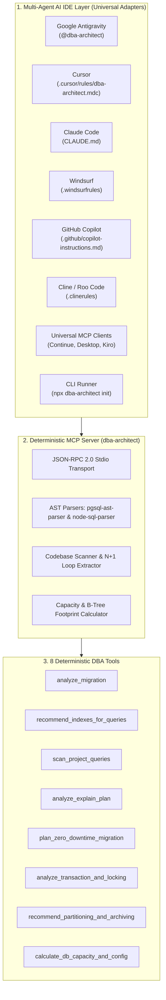

<div align="center">

# 🗄️ DBA-Architect

**Principal Database Administrator (DBA) & Data Architecture AI Skill Agent + MCP Server**  
*Autonomously audit SQL migrations, optimize composite B-Tree indexes via ESR rules, eliminate N+1 queries, diagnose EXPLAIN plans, execute zero-downtime migrations, and prevent transaction deadlocks for PostgreSQL & MySQL.*

[](LICENSE)
[](package.json)
[](https://nodejs.org)
[](https://www.typescriptlang.org)
[](https://modelcontextprotocol.io)
[](https://www.postgresql.org)
[](https://www.mysql.com)
[](tests)
[](https://www.w3.org/WAI/standards-guidelines/wcag/)

[English](README.md) | [Bahasa Indonesia](README.id.md)

</div>

---

## 🌟 Overview

**DBA-Architect** bridges the gap between software development and deep database performance engineering. Modern AI assistants often guess or generate naive SQL recommendations; **DBA-Architect** replaces guesswork with **8 deterministic AST & heuristic engines** built upon battle-tested database administration playbooks.

Whether you are authoring a DDL migration in Prisma, tuning an e-commerce order checkout transaction, or scaling a 50M-row table, DBA-Architect delivers deterministic audits, Mermaid visual execution plans, and non-blocking production runbooks directly to your AI Agent IDE.

### Core Pillars
* 🛡️ **Zero-Guesswork Deterministic Engine**: Built-in AST parsers (`pgsql-ast-parser`, `node-sql-parser`) enforcing 30+ strict DBA rules with a deterministic **Schema Health Score (0–100)**.
* 🌐 **Universal AI Agent Ecosystem**: First-class adapters for **Google Antigravity**, **Cursor**, **Anthropic Claude Code**, **Windsurf**, **GitHub Copilot**, **Cline / Roo Code**, **Continue.dev**, and **Kiro AI IDE**.
* ⚡ **ESR Index Engineering**: Implements the **Equality, Sort, Range** composite indexing algorithm, detects non-sargable predicates, and eliminates redundant left-prefix indexes.
* 🚀 **Zero-Downtime Migration Runbooks**: Converts blocking `ALTER TABLE` statements into phased **Expand & Contract** workflows (`CONCURRENTLY`, `NOT VALID` ➔ `VALIDATE`, `ALGORITHM=INPLACE`).
* 🔒 **Concurrency & Deadlock Prevention**: Detects lost update race conditions in financial paths, enforces pessimistic row-locking (`SELECT ... FOR UPDATE`), and flags dangerous external HTTP/network I/O inside transaction blocks.

---

## 🏗️ Architecture



---

## 🛠️ 8 Deterministic MCP Tools & Rules Matrix

DBA-Architect exposes 8 specialized tools adhering to the Model Context Protocol (MCP):

| # | MCP Tool Name | Functionality & Key Triggers | Primary Rules Enforced |
| :--- | :--- | :--- | :--- |
| **1** | `analyze_migration` | Audits SQL DDL, migration files, or migration directories. Computes deterministic **Health Score (0–100)**. | `SCHEMA-FLOAT-001`, `SCHEMA-FK-NOINDEX-001`, `SCHEMA-UUID-INNODB-001`, `SCHEMA-PG-ALIGN-001` |
| **2** | `recommend_indexes_for_queries` | Synthesizes optimal composite/covering B-Tree indexes via ESR rules and flags non-sargable query predicates. | `INDEX-ESR-001`, `INDEX-SARG-001..004`, `INDEX-REDUNDANT-001` |
| **3** | `scan_project_queries` | Traverses Go, PHP/Laravel, TypeScript/Prisma/Drizzle, and Python codebases to detect N+1 loops and synthesize table indexes. | `CODE-NPLUS1-001`, `CODE-RAW-PII-001` |
| **4** | `analyze_explain_plan` | Parses PostgreSQL/MySQL `EXPLAIN (ANALYZE, BUFFERS)` output, highlights execution bottlenecks, and outputs a Mermaid diagram. | `EXPLAIN-SCAN-001`, `EXPLAIN-SORT-001`, `EXPLAIN-ROWS-001` |
| **5** | `plan_zero_downtime_migration` | Formulates zero-downtime Expand & Contract runbooks with dual-writing, backfilling, and contract phases. | `MIGRATE-LOCK-001`, `MIGRATE-PHASE-001` |
| **6** | `analyze_transaction_and_locking` | Audits SQL & ORM transaction blocks to prevent lost updates, deadlocks, and external HTTP calls inside transactions. | `TX-RACE-001`, `TX-IO-001`, `TX-DEADLOCK-001` |
| **7** | `recommend_partitioning_and_archiving` | Designs declarative table partitioning (`RANGE`, `LIST`, `HASH`) for tables >10M rows and validates composite PK rules. | `PART-PK-001`, `PART-RETENTION-001` |
| **8** | `calculate_db_capacity_and_config` | Estimates tuple header overhead, table & index GB storage, working-set RAM fit, and tunes `postgresql.conf` or `my.cnf`. | `CAP-TUPLE-001`, `CONFIG-BUFFER-001` |

---

## 🚀 Installation & Setup

You can use DBA-Architect through any of the following methods depending on your development workflow:

### 🔌 Method A: MCP Server Setup (Recommended for AI IDEs)

Configure your AI IDE to fetch and execute the MCP server directly via `npx`:

#### 1. Google Antigravity & Gemini CLI
Add to your project's `mcp_config.json` or global config:
```json
{
  "mcpServers": {
    "dba-architect": {
      "command": "npx",
      "args": ["-y", "github:hanifalkauni/dba-architect"]
    }
  }
}
```

#### 2. Claude Desktop & Claude Code
Add to `claude_desktop_config.json`:
```json
{
  "mcpServers": {
    "dba-architect": {
      "command": "npx",
      "args": ["-y", "github:hanifalkauni/dba-architect"]
    }
  }
}
```

#### 3. Cursor & Continue.dev
In Cursor (`Features` ➔ `MCP Servers`) or Continue (`config.json`):
```json
{
  "name": "dba-architect",
  "command": "npx",
  "args": ["-y", "github:hanifalkauni/dba-architect"]
}
```

> **Note for Local Development**: If running from a local clone, replace `"command": "npx"` with `"command": "node"` and `"args": ["/path/to/dba-architect/dist/index.js"]`.

---

### 📦 Method B: Universal Skills CLI (`skills.sh`)

Install DBA-Architect with a single command into Cursor, Claude Code, Windsurf, Copilot, or Gemini CLI:
```bash
npx skills add hanifalkauni/dba-architect
```

---

### ⚡ Method C: One-Command Adapter Injection via CLI

Run this command inside any target repository to automatically generate and configure adapters for all supported IDEs:
```bash
npx -y github:hanifalkauni/dba-architect init
```

---

### 💻 Method D: Manual Adapter Installation per AI IDE

<details>
<summary><b>🤖 Google Antigravity & Gemini CLI</b></summary>

Copy the adapter to your workspace skill directory:
```bash
mkdir -p .agents/skills/dba-architect
cp adapters/antigravity/SKILL.md .agents/skills/dba-architect/SKILL.md
```
*(Or install globally at `~/.gemini/config/skills/dba-architect/SKILL.md`)*
</details>

<details>
<summary><b>🖱️ Cursor IDE</b></summary>

Copy rules to your Cursor rules directory:
```bash
mkdir -p .cursor/rules
cp adapters/cursor/dba-architect.mdc .cursor/rules/dba-architect.mdc
```
</details>

<details>
<summary><b>🧠 Anthropic Claude Code</b></summary>

Copy instructions to your project root:
```bash
cp adapters/claude/CLAUDE.md ./CLAUDE.md
```
</details>

<details>
<summary><b>🌊 Codeium Windsurf</b></summary>

Copy rules to your project root:
```bash
cp adapters/windsurf/.windsurfrules ./.windsurfrules
```
</details>

<details>
<summary><b>🐙 GitHub Copilot</b></summary>

Copy instructions to your GitHub repository directory:
```bash
mkdir -p .github
cp adapters/copilot/copilot-instructions.md .github/copilot-instructions.md
```
</details>

<details>
<summary><b>⚡ Kiro AI IDE (kiro.dev)</b></summary>

Copy steering and MCP configuration:
```bash
mkdir -p .kiro/steering
cp adapters/kiro/dba-architect.md .kiro/steering/dba-architect.md
cp adapters/kiro/config.json .kiro/config.json
```
</details>

---

## 📂 Repository Structure

```
dba-architect/
├── adapters/                           # Multi-Agent IDE Adapter Suite
│   ├── antigravity/SKILL.md            # Google Antigravity / Gemini CLI Skill
│   ├── claude/CLAUDE.md                # Anthropic Claude Code & Desktop
│   ├── cline/.clinerules               # Cline / Roo Code Rules
│   ├── continue/                       # Continue.dev Rules & MCP Configuration
│   ├── copilot/copilot-instructions.md # GitHub Copilot Custom Instructions
│   ├── cursor/dba-architect.mdc        # Cursor MDC Rules (Globs & Frontmatter)
│   ├── kiro/                           # Kiro AI IDE Steering & MCP Configuration
│   └── windsurf/.windsurfrules         # Windsurf Cascade Rules
├── src/                                # Core Engine Source Code
│   ├── adapters.ts                     # CLI Adapter Installer Engine
│   ├── index.ts                        # Unified Entrypoint (CLI Runner + MCP Stdio)
│   ├── server.ts                       # MCP Server Implementation & Schema Registry
│   ├── constants/                      # Deterministic DBA Rules & Heuristics Catalog
│   ├── parsers/                        # SQL AST & DDL Parsers (PG & MySQL)
│   ├── tools/                          # 8 Deterministic Tool Handlers
│   ├── types/                          # TypeScript Interfaces & Zod Schemas
│   └── utils/                          # Safe File Walker & Heuristics Utilities
├── tests/                              # Comprehensive Test Suite (Vitest)
│   └── dba-architect.test.ts           # 18 Unit & Integration Tests (100% Passing)
├── dba-architect.config.json           # Default Configuration Template
├── schema.json                         # JSON Schema for Configuration Validation
├── SKILL.md                            # Canonical Universal Agent Skill Playbook
├── package.json                        # Node.js Package Manifest & Dependencies
├── tsconfig.json                       # TypeScript Compiler Configuration
└── LICENSE                             # MIT Open-Source License
```

---

## 🧪 Testing & Verification

Run the test suite using Vitest to verify all 8 tools and adapter installations:

```bash
# Run unit & integration tests
npm test

# Run tests in watch mode
npm run test:watch

# Compile TypeScript
npm run build
```

---

## ❓ FAQ & Troubleshooting

<details>
<summary><b>1. Why does DBA-Architect recommend composite index order as Equality ➔ Sort ➔ Range (ESR)?</b></summary>

B-Tree indexes can only traverse a single range predicate efficiently. If a range condition is placed before equality or sort conditions, the database engine must scan all rows matching the range and filter the rest in memory or perform a separate sort step (`External merge Disk`). The ESR rule ensures optimal index selectivity and eliminates unnecessary sorting.
</details>

<details>
<summary><b>2. How does DBA-Architect prevent locking issues during zero-downtime migrations?</b></summary>

In PostgreSQL, standard `CREATE INDEX` acquires a `SHARE` lock that blocks writes (`INSERT`/`UPDATE`/`DELETE`). DBA-Architect automatically converts these to `CREATE INDEX CONCURRENTLY` and splits foreign key additions into `ADD CONSTRAINT ... NOT VALID` followed by `VALIDATE CONSTRAINT` to avoid long-running exclusive locks. In MySQL, it generates `ALGORITHM=INPLACE, LOCK=NONE`.
</details>

<details>
<summary><b>3. Why is random UUIDv4 discouraged as a Clustered PK in MySQL InnoDB?</b></summary>

MySQL InnoDB physically orders table rows on disk based on the Clustered Primary Key. Inserting non-sequential random UUIDv4 strings forces arbitrary page insertions, triggering high rates of B-Tree page splits (50% fragmentation) and massive random I/O. DBA-Architect enforces sequential UUIDv7 or `BIGINT AUTO_INCREMENT`.
</details>

<details>
<summary><b>4. What happens if I run `npx dba-architect init` multiple times?</b></summary>

The command is fully idempotent. It safely overwrites adapter files to match the latest template version while preserving any custom changes if your project already contains customized rules.
</details>

---

## 🛡️ Security Policy & Guardrails

DBA-Architect operates strictly under static, read-only analysis principles:
- **Zero Production Execution**: DBA-Architect does not connect to live production databases or execute destructive DDL directly. It outputs verified DDL scripts and runbooks for human review.
- **Sensitive File Protection**: Built-in file traversal guardrails automatically reject access to `.env`, private keys (`.pem`, `.key`), certificates, and `.git` files.
- **Data Privacy & Masking**: Query scanners automatically mask literals and personal identifiers (`PII`) before analyzing query structures.

---

## 📜 License

This project is licensed under the MIT License. See the [LICENSE](LICENSE) file for details.

SPDX-License-Identifier: MIT
