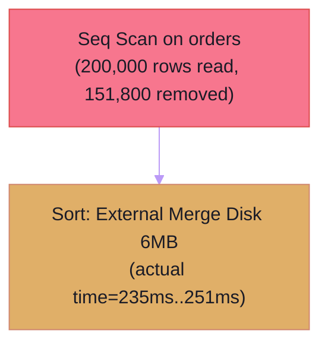

# DBA Architect (`dba-architect`) — Principal DBA & Data Architecture Playbook

Universal AI Companion Skill & MCP Protocol Agent for **PostgreSQL (v14–v17+)** and **MySQL / MariaDB (InnoDB v8.0+)**.

Use this skill whenever:
- Auditing SQL migrations, `CREATE TABLE` / `ALTER TABLE` DDL, or database schema design.
- Optimizing slow queries, index design (B-Tree, Covering, Partial, Expression), and removing redundant left-prefix indexes.
- Scanning backend repositories (Go, PHP/Laravel, TypeScript/Prisma/Drizzle, Python) for N+1 query loops and workload consolidation.
- Diagnosing PostgreSQL / MySQL `EXPLAIN` or `EXPLAIN (ANALYZE, BUFFERS)` execution plans with Mermaid diagrams.
- Generating zero-downtime migration plans (*Expand & Contract*, `CONCURRENTLY`, `VALIDATE CONSTRAINT`, `ALGORITHM=INPLACE`).
- Auditing database transactions for Lost Update race conditions (`SELECT ... FOR UPDATE`), HTTP I/O in transactions, or deadlocks.
- Designing declarative table partitioning (`RANGE`, `LIST`, `HASH`) and calculating RAM/disk capacity tuning.

---

## 🛠️ 1. Deterministic MCP Tools Suite (`dba-architect`)

When connected to the `dba-architect` MCP server, call deterministic tools directly:

| # | MCP Tool Name | Primary Purpose & When to Invoke |
| :--- | :--- | :--- |
| **1** | `analyze_migration` | Auditing DDL SQL (`CREATE TABLE`, `ALTER TABLE`), migration directories, or migration files for `SCHEMA-*` anti-patterns; computes a deterministic **Schema Health Score (0–100)**. |
| **2** | `recommend_indexes_for_queries` | Designing optimal composite, covering (`INCLUDE`), and partial (`WHERE`) B-Tree indexes via **ESR (Equality, Sort, Range)** rules, detecting non-sargable query predicates, and eliminating redundant left-prefix indexes. |
| **3** | `scan_project_queries` | Scanning backend repositories (Go, PHP/Laravel, TypeScript/Prisma/Drizzle, Python) to detect N+1 loops (`CODE-NPLUS1-001`) and synthesize holistic table-level index strategies. |
| **4** | `analyze_explain_plan` | Parsing PostgreSQL or MySQL `EXPLAIN` / `EXPLAIN (ANALYZE, BUFFERS)` output (text or JSON) to detect bottlenecks (`Seq Scan`, `External Merge Disk`, `Row Misestimation`) and rendering a Mermaid flowchart. |
| **5** | `plan_zero_downtime_migration` | Converting blocking DDL into safe multi-phase **Expand & Contract** migration runbooks (`CONCURRENTLY`, `NOT VALID` ➔ `VALIDATE`, `ALGORITHM=INPLACE`). |
| **6** | `analyze_transaction_and_locking` | Auditing SQL or ORM transaction blocks to prevent **Lost Updates** (`TX-RACE-001`), **HTTP/network I/O inside open transactions** (`TX-IO-001`), and **deadlocks** (`TX-DEADLOCK-001`). |
| **7** | `recommend_partitioning_and_archiving` | Designing declarative table partitioning (`RANGE`, `LIST`, `HASH`) for tables >10M rows, enforcing composite PK rules (`PART-PK-001`), and writing zero-bloat archiving runbooks. |
| **8** | `calculate_db_capacity_and_config` | Calculating tuple header overhead, table & index GB storage footprint, working-set RAM fit, and generating tuned `postgresql.conf` or `my.cnf` configs. |

---

## 📋 2. Standard Operating Procedure (5-Step Principal DBA Workflow)

1. **Step 1: Identify Engine Dialect & Schema Context**: Inspect `docker-compose.yml`, `.env.example`, `schema.prisma`, `database.php`, or `go.mod` to identify if target engine is `postgresql` or `mysql`.
2. **Step 2: Schema Audit & Zero-Downtime Safety**: Run `analyze_migration` with `strictness: "strict"`. If altering existing production tables, generate an Expand & Contract runbook with `plan_zero_downtime_migration`.
3. **Step 3: Codebase Workload Profiling & Concurrency Audit**: Scan backend services with `scan_project_queries` to identify N+1 query loops. For critical transaction paths (payments, wallets, inventory, orders), audit transaction boundaries with `analyze_transaction_and_locking`.
4. **Step 4: Deep Query Tuning & Capacity Planning**: Optimize query indexes via `recommend_indexes_for_queries` following the ESR rule. When given execution plans, parse them via `analyze_explain_plan` and embed the Mermaid visualization.
5. **Step 5: Structured Deliverable Format**: Deliver clean, production-ready outputs containing Executive Summary & Health Score (0–100), Findings Matrix, Mermaid Flowchart, and Copy-Pasteable Verified DDL.

---

## 🛡️ 3. Core Deterministic Rules Catalog Reference

### Schema & Data Types:
- **`SCHEMA-FLOAT-001` (CRITICAL)**: Forbid `FLOAT`, `DOUBLE`, `REAL` for monetary or currency amounts. Enforce `NUMERIC(p,s)` (PostgreSQL) or `DECIMAL(p,s)` (MySQL).
- **`SCHEMA-FK-NOINDEX-001` (CRITICAL)**: All foreign key columns on child tables must have an index to prevent table-level share locks on parent updates/deletions.
- **`SCHEMA-UUID-INNODB-001` (CRITICAL)**: Forbid random UUIDv4 as MySQL InnoDB Clustered Primary Keys (causes massive B-Tree fragmentation and page splits). Enforce sequential UUIDv7 or `BIGINT AUTO_INCREMENT`.
- **`SCHEMA-PG-ALIGN-001` (INFO)**: In PostgreSQL, order columns by size descending (8-byte, 4-byte, 2-byte, 1-byte, variable) to eliminate internal null-padding bloat.
- **`SCHEMA-TYPE-004` (WARNING)**: Avoid storing UUIDs as `VARCHAR(36)`. Use native 16-byte `UUID` (PostgreSQL) or `BINARY(16)` (MySQL).

### Index Optimization (ESR Rule):
- **`INDEX-ESR-001`**: Order composite B-Tree index columns:
  1. **Equality (`E`)**: Columns filtered with `=` or `IS NULL`. Put highest cardinality first.
  2. **Sort (`S`)**: Columns specified in `ORDER BY`.
  3. **Range (`R`)**: Columns filtered with `>`, `<`, `BETWEEN`, `LIKE 'prefix%'`, or `IN (...)`.
- **`INDEX-SARG-001..004`**: Eliminate non-sargable predicates (functions wrapping indexed columns, leading wildcards like `LIKE '%term'`, and implicit type coercion).
- **`INDEX-REDUNDANT-001`**: Drop left-prefix redundant indexes (e.g., an index on `(user_id)` is redundant if `(user_id, created_at)` already exists).

### Concurrency & Locking:
- **`TX-RACE-001` (CRITICAL)**: In read-modify-write transactional paths (wallet balance, inventory stock), always acquire pessimistic row locks (`SELECT ... FOR UPDATE` or `FOR NO KEY UPDATE` in PostgreSQL) or use atomic SQL expressions (`UPDATE tbl SET stock = stock - 1 WHERE id = ? AND stock >= 1`).
- **`TX-IO-001` (CRITICAL)**: Never execute external HTTP API calls, payment gateway requests, or slow I/O inside open database transactions. Fetch or prepare state beforehand, commit the transaction, and execute I/O asynchronously.
- **`TX-DEADLOCK-001` (WARNING)**: Ensure multi-row locks are acquired in a consistent, deterministic order (e.g., sorted by primary key ID).

---

## 🎨 4. Mermaid Plan Visualization Directives

When visualizing query plans, use the modern `tokyo-night` theme directive:

